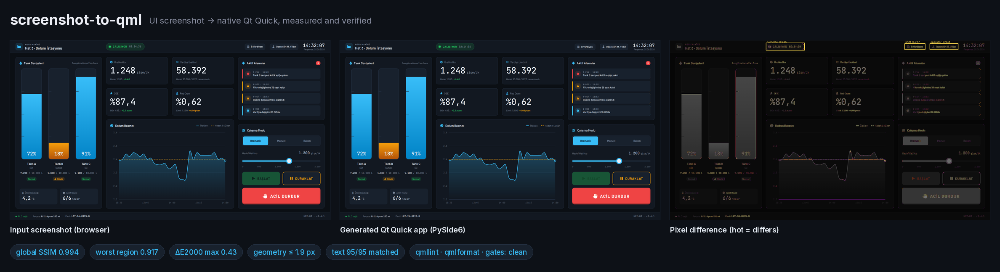
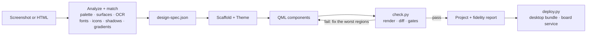
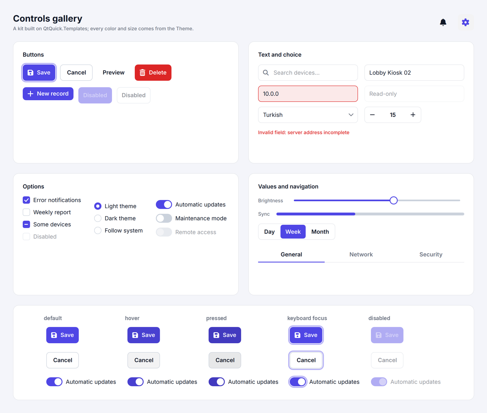
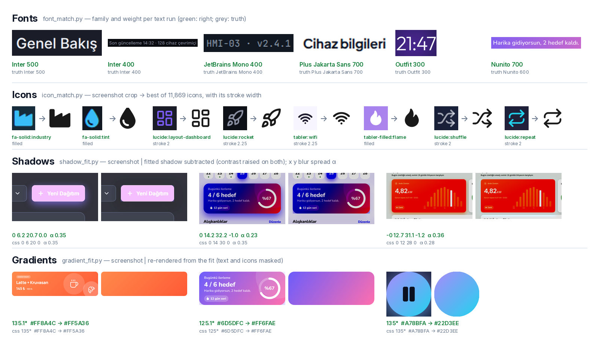
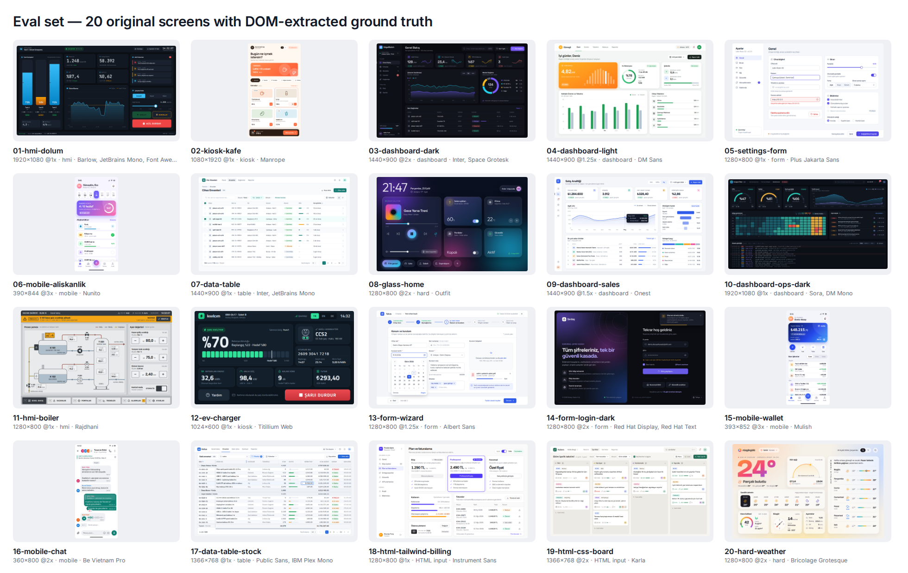

<h1 align="center">screenshot-to-qml</h1>

<p align="center">
  <strong>An agent skill that turns a UI screenshot or HTML page into a production Qt Quick app,<br>
  then renders the result and proves it matches.</strong>
</p>

<p align="center">
  <a href="https://github.com/ozaysahin/screenshot-to-qml/actions/workflows/ci.yml"></a>
  <a href="CHANGELOG.md"></a>
  <a href="LICENSE"></a>
  <a href="https://agentskills.io"></a>
  
  
</p>

<p align="center">
  <a href="#install">Install</a> ·
  <a href="#usage">Usage</a> ·
  <a href="#how-it-works">How it works</a> ·
  <a href="#results">Results</a> ·
  <a href="evals/README.md">Evals</a> ·
  <a href="CHANGELOG.md">Changelog</a>
</p>

<p align="center">
  
</p>

Most "image to UI" prompts stop at *looks about right*. **screenshot-to-qml** gives a coding
agent (Claude Code, Codex CLI and others) a measured workflow instead: it reads exact colors,
spacing, fonts and icons off the screenshot, builds a tokenized QML project, renders it
headlessly at the screenshot's size and DPR, and scores it against the source until it passes.
The result is native Qt: no browser, no WebView, from desktops down to a Raspberry Pi panel.

## Features

- **Measured, not guessed.** Colors, edges, borders and padding are probed from the pixels and
  stored in a `design-spec.json`, each value with its source and confidence. Given HTML (plain
  CSS or Tailwind), the page is rendered in Chromium and the exact values, text runs, icon SVGs
  and font files come from the DOM.
- **Matched, not eyeballed.** The font family and weight of every text run (63 open UI
  families), the icon set and name of every icon (11,869 icons from Lucide, Tabler, Font
  Awesome and Heroicons), CSS shadows and linear gradients are fitted from the image. A font
  that is not in the catalog is flagged instead of silently swapped.
- **Production QML.** One `Theme` singleton holds every token. 14 `QtQuick.Templates` controls
  cover hover, pressed, focus, checked, error and disabled states. Repeats come from models,
  every string is `qsTr()`-ready, and the code passes `qmllint` and `qmlformat`.
- **Verified.** `check.py` reports global and per-region SSIM, CIEDE2000 color error, geometry
  offsets and the position of every string, and runs 13 quality gates, including keyboard
  reachability and visible focus driven by real input to the running window.
- **One QML tree, two hosts.** The same `qml/` runs from PySide6 or compiles into a C++ binary
  with CMake (Qt 6.8+, QML compiled ahead of time). Both renders are compared.
- **Down to the board.** Profiles for desktop, GPU boards (Raspberry Pi, Jetson) and GPU-less
  panels (software renderer), with kiosk packaging: eglfs/linuxfb, systemd unit, installer.

## Install

The skill is a plain [Agent Skills](https://agentskills.io) folder:
[`skills/screenshot-to-qml`](skills/screenshot-to-qml).

### Any agent: `npx skills`

```bash
npx skills add ozaysahin/screenshot-to-qml                                # pick agents interactively
npx skills add ozaysahin/screenshot-to-qml -g -a claude-code -a codex      # user-level, Claude Code + Codex
```

The [skills CLI](https://skills.sh) installs into the folder each agent reads (Claude Code,
Codex, Cursor, Gemini CLI, GitHub Copilot and many more). Without `-g` it installs into the
current project.

### Claude Code plugin

```text
/plugin marketplace add ozaysahin/screenshot-to-qml
/plugin install screenshot-to-qml@screenshot-to-qml
```

On Claude Code 2.1.275 or later, one line does both:
`/plugin install screenshot-to-qml --marketplace ozaysahin/screenshot-to-qml`.

### Manual

```bash
git clone https://github.com/ozaysahin/screenshot-to-qml
cp -r screenshot-to-qml/skills/screenshot-to-qml ~/.claude/skills/       # Claude Code, all projects
cp -r screenshot-to-qml/skills/screenshot-to-qml ~/.agents/skills/       # Codex CLI
```

Any agent that can read files and run Python can also be pointed at the folder: *"Read
skills/screenshot-to-qml/SKILL.md and follow it."*

### Dependencies

The agent installs these when it first runs the skill (SKILL.md has a Setup section). To do it
yourself:

```bash
pip install -r skills/screenshot-to-qml/scripts/requirements.txt   # PySide6 6.8+, numpy, opencv, scikit-image …
python skills/screenshot-to-qml/scripts/font_match.py fetch         # font catalog, ~40 MB from google/fonts
python skills/screenshot-to-qml/scripts/icon_match.py fetch         # icon index, ~170 MB (needs npm)
```

| Also needed | For | Install |
| --- | --- | --- |
| Tesseract with `tur` + `eng` | OCR in the screenshot analysis | `apt install tesseract-ocr tesseract-ocr-tur` · `brew install tesseract tesseract-lang` · [UB Mannheim installer](https://github.com/UB-Mannheim/tesseract) on Windows |
| Xvfb | headless rendering on Linux servers | `apt install xvfb libxcb-cursor0` |
| Playwright + Chromium | HTML input only | `pip install playwright && python -m playwright install chromium` |
| Qt 6.8+ with CMake files | the C++ host only | Qt online installer, `aqt`, or a distro with Qt 6.8 (Debian 13) |

On Windows, set `PYTHONUTF8=1` before running the scripts.

## Usage

Give the agent a screenshot (or an HTML file) and say what you need:

```text
Rebuild this screen as a PySide6 Qt Quick app for a 1920×1080 kiosk.
```

```text
Turn dashboard.html into a C++ Qt app for a 7" Raspberry Pi 5 panel.
```

```text
Rebuild settings.png (exported at 2×) as a desktop app with English and Turkish translations.
```

The agent analyzes the image, asks only what it cannot measure (for example a font that is not
in the catalog), builds the project, and iterates on the worst regions until the check passes.
You get:

```text
project/
├── main.py                  PySide6 host (fonts, translations, frame grab)
├── CMakeLists.txt, src/     optional C++ host for the same QML
├── qml/App/
│   ├── Main.qml             Window root, screen composition
│   ├── *.qml                components (cards, charts, panels …)
│   ├── Style/Theme.qml      every color, font, radius and spacing token
│   └── Controls/            Template-based controls with all their states
├── assets/fonts, icons      bundled fonts and SVG icons with their licenses
├── i18n/                    translations
└── README.md                assumptions, run instructions, fidelity report
```

To check a project yourself:

```bash
python skills/screenshot-to-qml/scripts/check.py project --source input.png --spec design-spec.json
```

## How it works



<details>
<summary><strong>Scripts</strong> (each prints <code>--help</code> and JSON output)</summary>

| Script | Does |
| --- | --- |
| `analyze.py` | draft spec: palette, surfaces, gradient candidates and OCR, with a numbered overlay |
| `html_to_spec.py` | HTML input: renders the page in Chromium → reference PNG and a spec of exact values, icon SVGs, font files |
| `match.py` | fonts, icons, shadows and gradients measured into the spec, with a report of what to confirm |
| `font_match.py` · `icon_match.py` · `shadow_fit.py` · `gradient_fit.py` | the four matchers on their own (`fetch` builds the font and icon caches) |
| `validate_spec.py` · `gen_theme.py` | spec checks; spec tokens → `Theme.qml` / `Icons.qml` |
| `probe.py` | colors at points, dominant colors of a box, edge/border/padding runs, zoomed crops |
| `scaffold.py` | new project with the control kit, a PySide6 host, a C++ host or both |
| `render.py` | headless render at size × DPR and a scene dump; `--interact` drives Tab, hover and press |
| `diff.py` | SSIM (global and per region), ΔE2000, template-matched geometry, text matching |
| `quality_gate.py` | lint, format, runtime warnings, literals, screenshot embedding, fonts, web engine, a11y, states, i18n, effects, perf, cpp |
| `build_cpp.py` | builds the C++ host, grabs a frame and compares it with the PySide6 render |
| `check.py` | all of the above in one command |
| `deploy.py` | pyside6-deploy or `cmake --install` bundles for desktops; env file, systemd unit and installer for boards |

</details>

**Quality gates.** A build fails on hard-coded colors, QML warnings, web engines, screenshots
pasted in as backgrounds, controls that Tab cannot reach or that show no focus or pressed
state, missing accessible names, untranslatable strings, effects the target cannot draw,
images or animations an embedded board cannot afford, and a C++ build that fails or draws a
different frame.

### Reference result

The HMI above ([`examples/hmi-dolum`](skills/screenshot-to-qml/examples/hmi-dolum)), a
1920×1080 screenshot rebuilt in production mode:

| Metric | Result | Gate |
| --- | --- | --- |
| Global SSIM (text masked) | 0.994 | ≥ 0.98 |
| Worst region SSIM | 0.943 | ≥ 0.90 |
| Color ΔE2000 (max over surfaces) | 0.43 | ≤ 2.0 |
| Geometry offset (max) | 1.9 px | ≤ 2 px |
| Text strings found / max offset | 95 of 95 / 1.8 px | 100 % / ≤ 2 px |
| 13 quality gates | clean | 0 errors |
| C++ host's frame vs the PySide6 render | SSIM 1.000 | ≥ 0.98 |

### Control kit

<p align="center">
  
</p>

Every new project gets 14 Template-based controls styled only through Theme roles. When the
design does not show hover, pressed, focus or danger colors, they are derived from its own
tokens. The [gallery](skills/screenshot-to-qml/examples/controls-gallery) ships in English with
a Turkish translation and passes all 13 gates.

## Results

Twenty original eval screens (dashboards, HMIs, a kiosk, forms, phone screens, dense tables,
two HTML pages and two hard cases), each built once by an agent that sees only its input and
the skill, scored against ground truth extracted from the live DOM.
[Full results](evals/results/2026-10-18-v1.0/README.md).

**Skill v1.0 with Claude Opus, all 20 cases:**

| Criterion | Result |
| --- | --- |
| Global SSIM ≥ 0.95 (text masked) | **20 / 20** (min 0.987, mean 0.995) |
| Region SSIM ≥ 0.90 (each region aligned within 1 px) | 18 / 20 |
| Color error ΔE2000 ≤ 2 on solid fills | **19 / 19** measured (max 1.1) |
| Position and size error ≤ 2 px | 18 / 20 |
| Zero runtime QML warnings · lint clean | **20 / 20** · 19 / 20 |
| Controls reachable with Tab, focus visible | **337 / 337** |

16 of 20 builds meet every criterion at once. Under the stricter calibrated thresholds (global
SSIM ≥ 0.98, every string within 2 px, all 13 gates) 12 of 20 pass outright, and each miss is
one to three items: a dashed chip, a 28 px badge, a dash typed as a hyphen, a value 3–4 px off.

**Against the same model without the skill** (cases 01–08):

| | Without skill | Skill v1.0 |
| --- | --- | --- |
| Full pass (visual checks + all gates) | 0 / 8 | **4 / 8** |
| Visual checks only | 6 / 8 | 4 / 8 |
| Controls reachable with Tab, focus visible | 9 / 19 | **153 / 153** |
| `MouseArea`s posing as buttons | 46 | **0** |
| Runtime warnings · hard-coded values · untranslatable strings | 48 · 239 · 142 | **0 · 0 · 0** |

A strong model already copies the pixels well, and on these eight it passed the visual checks
more often without the skill (one build per case, so ±1 case is noise). What the skill adds is
everything a real codebase needs around the pixels: design tokens, keyboard and screen-reader
support, clean lint, translatable text and a verified fidelity report.

**Other models and agents** (shared cases):

| | Cases | All gates pass | Full pass |
| --- | --- | --- | --- |
| Claude Opus | 05, 09, 12, 18 | 4 / 4 | 3 / 4 |
| Claude Sonnet | 05, 09, 12, 18 | 4 / 4 | 2 / 4 |
| Claude Haiku | 05, 12, 18 | 3 / 3 | 0 / 3 |
| Codex CLI (two runs) | 05, 09, 12, 18 | 4 / 4 | 1 / 4 |

The production rules carry over to every model and agent tested. Visual fidelity does not
yet: Haiku leaves more text 2–4 px off, and Codex CLI got the HTML case right but missed the
three screenshot cases on fonts and text position, on a machine whose font catalog was most
likely incomplete ([details](evals/results/2026-10-18-v1.0/README.md#codex-cli-two-runs-2026-10-19)).

<details>
<summary><strong>Analysis and matcher accuracy</strong></summary>

<br>

The analyzers and matchers were tuned on cases 01–08; cases 09–20 are unseen screens for them.

| Analysis (`evals/score_analysis.py`) | Cases 01–08 | Cases 09–20 |
| --- | --- | --- |
| Palette recall (ΔE ≤ 2) | 95.8 % | 95.2 % |
| Surface recall (IoU ≥ 0.85) | 97.3 % | 93 % (70 % with case 10's 168-cell heatmap) |
| OCR exact strings · character error rate | 76 % · 12 % | 71 % · 14 % |
| Font size error | 1.2 px | 1.5 px |

| Matcher (`evals/score_matching.py`, `evals/synthetic_matching.py`) | Cases 01–08 | Cases 09–19 | Synthetic images |
| --- | --- | --- | --- |
| Font family per run / weight ±100 | 95 % / 96 % | 93 % / 93 % | 95 % / 100 % (17 other families) |
| Font outside the catalog flagged | 0 false flags | 0 false flags | 7 of 12 faces, 0 of 17 false |
| Icons top-1 / top-3 (of 11,869) | 90 % / 94 % | 94 % / 96 % | — |
| Shadows found / false alarms | 31 of 44 / 0 of 78 | 46 of 79 / 10 of 217 | 24 of 24 |
| Gradients accepted / solid fills misread | 7 of 8 / 0 of 49 | 4 of 5 / 0 of 73 | angle error 0.04° |

Case 20's font is outside the catalog by design and is flagged. The weak spot is shadows on busy
or dark backdrops: in the glassmorphism case only 4 of 13 are found. Per-case numbers are in
[`evals/matching-results.md`](evals/matching-results.md) and
[`evals/synthetic-results.md`](evals/synthetic-results.md).

<p align="center"></p>

</details>

### Eval set

<p align="center"></p>

All twenty screens are original designs with fictional brands, built from HTML so that every
color, box, string and font is known exactly. [`evals/`](evals/README.md) holds the cases, the
builder, the scorer, and a harness that hands any agent the same folders and prompt
(`prepare_run.py`, `run_agent.py`), so you can rerun the comparison with your own agent or
model.

## Platform support

| Platform | Status |
| --- | --- |
| Linux (Ubuntu 24.04) | tested: CI, every eval run |
| Windows | used for the Codex runs; set `PYTHONUTF8=1`, Tesseract must be on `PATH` |
| macOS | not tested yet |
| Targets | desktop · `embedded-gpu` (Raspberry Pi, Jetson; eglfs) · `embedded-sw` (software renderer; linuxfb) |

## Limitations

- Qt Quick's `Rectangle` has no dashed border; dashed outlines are approximated and show in
  region scores.
- Shadows on busy or dark backdrops (glass, photos) are often missed by the fitter.
- Fonts outside the 63-family catalog are flagged, not identified: the agent asks for the font
  or names the closest substitute.
- One build per case per arm: differences of about one case between arms are within noise.

## Repository layout

```text
skills/screenshot-to-qml/   the installable skill: SKILL.md, references/, scripts/, assets/, examples/
.claude-plugin/             Claude Code plugin marketplace manifest
evals/                      20 cases, case builder, scorers, agent harness, results
tests/                      pytest suite: scripts, schema, control kit, gates, renders, C++ builds
docs/                       README images; docs/tools draws the eval and matcher sheets
```

## Roadmap

| Version | Scope | Status |
| --- | --- | --- |
| 0.2 – 0.4 | skill structure, render / diff / gates, eval set, automatic analysis | ✅ |
| 0.5 | production control kit; a11y, states and i18n gates | ✅ |
| 0.6 | font, icon, shadow and gradient matching | ✅ |
| 0.7 | C++ host, embedded profiles, deployment | ✅ |
| 1.0 | 20 eval cases, HTML input, multi-model and Codex CLI runs | ✅ |
| 1.1 | automotive instrument cluster case; Codex CLI on more cases with a verified font catalog | next |

## Contributing

Issues and pull requests are welcome. See [CONTRIBUTING.md](CONTRIBUTING.md): run `ruff check .`
and `pytest` before a PR, and build new eval cases with `evals/tools/build_case.py`.

## License

MIT for the code, docs and eval designs. Bundled fonts are under the SIL Open Font License
1.1; bundled icons come from Lucide (ISC), Tabler Icons (MIT) and Font Awesome Free (icons
CC BY 4.0, fonts OFL 1.1). License texts are in [`evals/assets/licenses`](evals/assets/licenses).
The icon matcher also downloads Heroicons (MIT) into its cache; it is not bundled.
